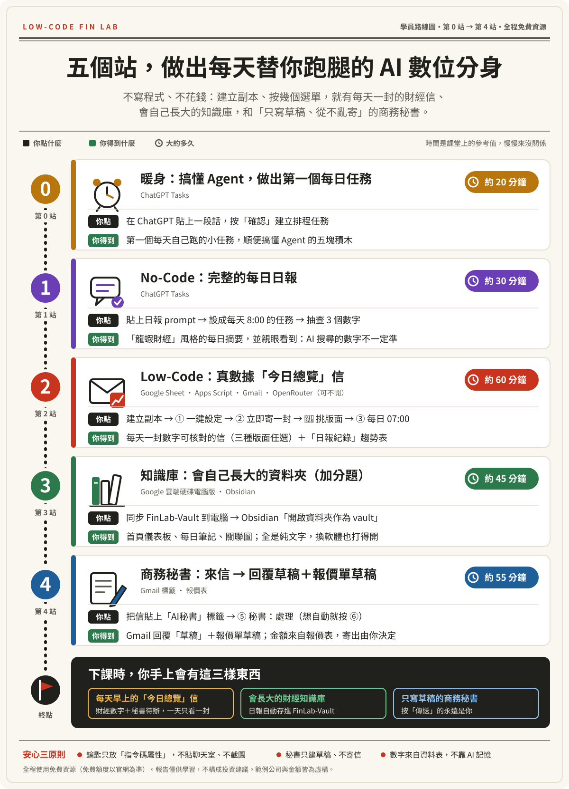
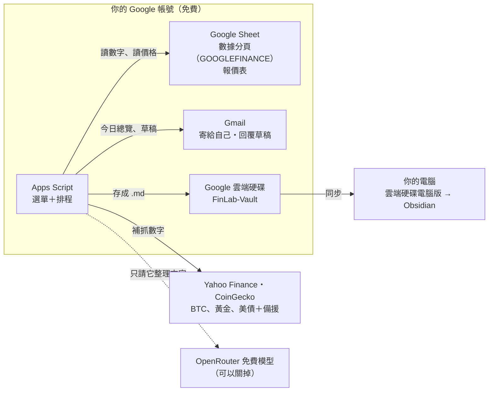
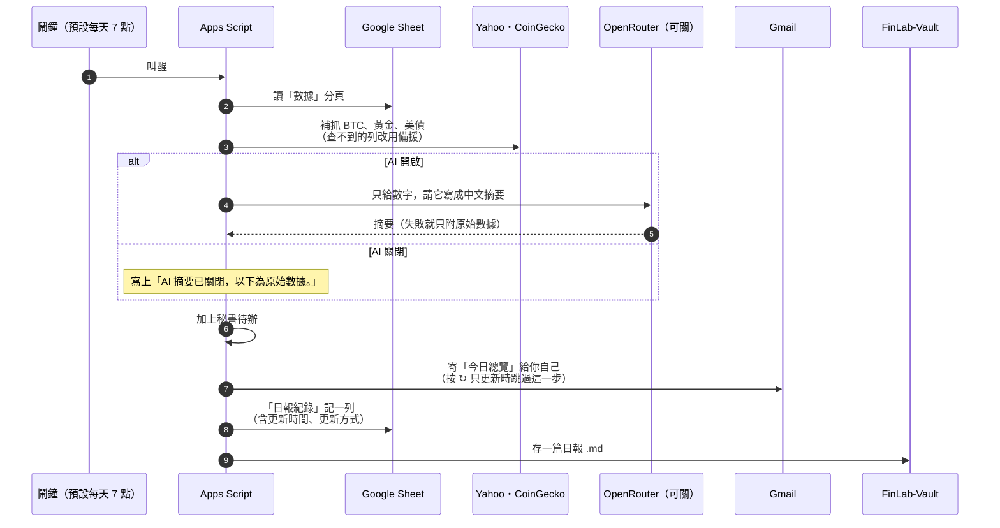
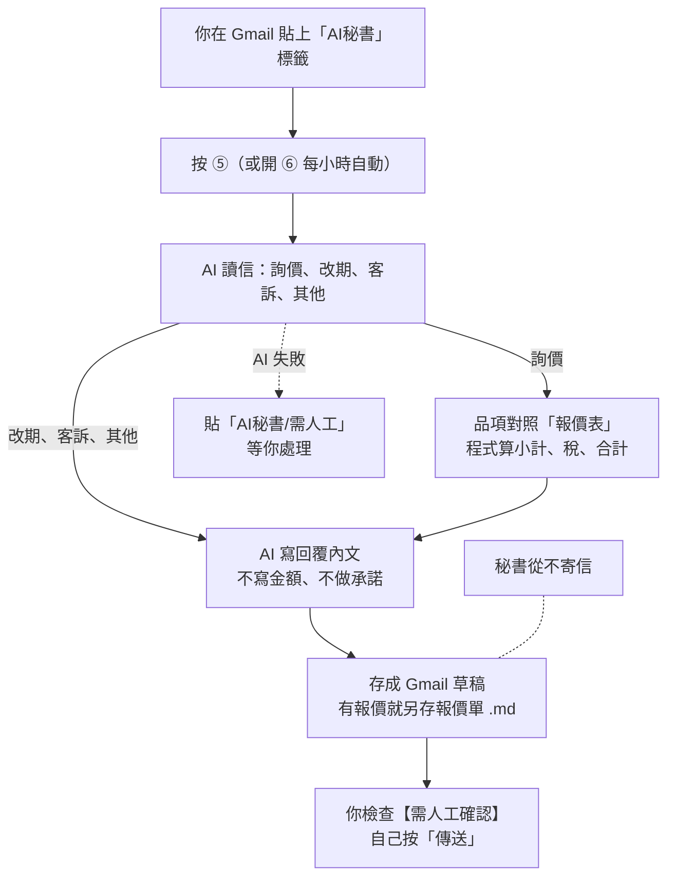
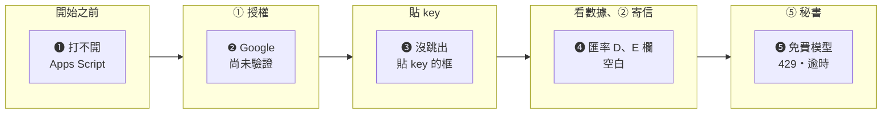

# 一張圖看懂全程：你的 AI 數位分身路線圖

> 覺得路很長？先看這一頁就好。整趟只有 5 站，每一站都是「點幾下 → 拿到一樣東西」，全部使用免費資源。
> 每一站的詳細步驟，點下面的連結回到各 Stage 講義。
>
> 網頁版：[slides/journey-map.html](../../slides/journey-map.html)

**目錄**：[你會做出什麼](#你會做出什麼) ・ [路線圖](#路線圖) ・ [誰跟誰說話](#誰跟誰說話) ・ [每天早上發生什麼事](#每天早上發生什麼事) ・ [秘書怎麼處理一封信](#秘書怎麼處理一封信) ・ [你只需要按這些按鈕](#你只需要按這些按鈕) ・ [安全感](#安全感) ・ [卡關了怎麼辦](#卡關了怎麼辦)

## 你會做出什麼

**不寫一行程式、不花一塊錢，上班族四小時做出自己的 AI 數位分身。** 從明天起，每天早上信箱會收到一封「今日總覽」：匯率、股票、黃金、比特幣，數字直接取自資料表，AI 只負責把它寫成好讀的中文；同一份日報會自動存進雲端硬碟的 `FinLab-Vault`，在 Obsidian 裡變成一個會自己長大的知識庫；客戶來信只要貼上一個標籤，秘書就會替你擬好回覆草稿和報價單草稿。最後要不要按「傳送」，永遠由你決定。

## 路線圖

| 站 | 講義 |
|---|---|
| 0 暖身 | [student-stage-0-concepts.md](student-stage-0-concepts.md) |
| 1 No-Code 日報 | [student-stage-1-lab.md](student-stage-1-lab.md) |
| 2 今日總覽信 | [student-stage-2-lab.md](student-stage-2-lab.md) |
| 3 知識庫（加分題） | [student-stage-3-obsidian-lab.md](student-stage-3-obsidian-lab.md) |
| 4 商務秘書 | [student-stage-4-secretary-lab.md](student-stage-4-secretary-lab.md) |

> 時間是課堂上的參考值。第 3 站是加分題，公司電腦不能裝軟體的人，跳過也完全沒問題。

## 誰跟誰說話

從第 2 站開始，所有東西都裝在**你自己的 Google 帳號**裡。Apps Script 是試算表內建的小程式，負責跑腿；其他都是它會去敲門的地方。

- 實線是一定會發生的事；虛線的 OpenRouter 可以關掉，關掉後信裡就只放原始數據。
- 黃金、美債殖利率、比特幣不在試算表裡，由程式另外去 Yahoo Finance、CoinGecko 抓；試算表某列查不到數字時，匯率與台股加權指數也會改用 Yahoo 備援。

## 每天早上發生什麼事

按下「③ 開啟每日 07:00 自動寄送」之後，每天 7 點這個小時內，會自動跑一次下面的流程。你什麼都不用做，等著收信就好。想換時間，見下方按鈕表的 ③。

## 秘書怎麼處理一封信

秘書只做到「草稿」為止。價格一律由「報價表」計算，AI 碰不到金額。

## 你只需要按這些按鈕

全部都在試算表上方的選單 **📰 我的 AI 助理**，不用打開程式編輯器。

| 選單上的字 | 按下去會怎樣 | 什麼時候按 |
|---|---|---|
| ① 一鍵設定（第一次用） | 跳出授權，再請你貼 OpenRouter key（可以留空），並在雲端硬碟建好 `FinLab-Vault` 資料夾 | 第一次用；想換 key、或想把 AI 打開時 |
| ② 立即寄一封今日總覽 | 馬上寄一封今日總覽給你，同時記一列「日報紀錄」、存一篇日報到 `FinLab-Vault/日報` | 想立刻看結果時 |
| ↻ 只更新數字與知識庫（不寄信） | 跟 ② 一樣抓最新數字、更新「日報紀錄」與今天的日報 `.md`，但不寄信。AI 開著的話，每按一次用掉 1～2 次免費額度（以官網為準，查證日期 2026-11-24）。AI 摘要失敗時，今天的日報 `.md` 會被改寫成只有原始數據 | 想看最新數字、又不想多收一封信時 |
| 🎨 選擇信件版面 | 輸入編號，選精簡、完整或表格版面（預設是完整） | 看完樣張之後 |
| 🎨 寄三種版面樣張給我 | 一次寄 3 封，同一份內容用三種版面排給你比較 | 還不確定喜歡哪種版面時 |
| ③ 開啟每日 07:00 自動寄送 | 之後每天 7 點這個小時內自動寄出。想換時間：在 Apps Script「專案設定 → 指令碼屬性」把 `REPORT_HOUR` 設成 0～23（例如 `6`），**再按一次 ③** 才生效 | 試寄滿意之後；改了時間之後 |
| ④ 停止每日自動寄送 | 不再每天寄信 | 想暫停時 |
| ⑤ 秘書：處理「AI秘書」標籤的信 | 讀貼著「AI秘書」標籤的信，一次最多 5 封，建立回覆草稿與報價單草稿（不寄出） | 貼好標籤之後 |
| ⑥ 秘書：開啟每小時自動處理 | 之後每小時自動檢查一次「AI秘書」標籤，一樣只建草稿 | 想讓秘書自己上班時（選做） |
| ⑦ 秘書：停止自動處理 | 秘書不再自動檢查 | 想暫停時 |

> ⑤⑥ 需要 AI 開啟才能判讀信件。AI 關閉時按下去，只會跳出說明，不會出錯。

## 安全感

> [!IMPORTANT]
> **這套流程刻意設計得很保守，你可以放心按。**
>
> - **鑰匙放在哪裡**：OpenRouter key 由「① 一鍵設定」存進這份檔案的「指令碼屬性」，不會出現在表格裡。不要把 key 貼進聊天室、群組、表格或截圖；外洩了就到 OpenRouter 的 Keys 頁面刪掉重建。整個流程**從頭到尾都不需要你的 Gmail 密碼**。
> - **秘書只寫草稿**：秘書只會在 Gmail「草稿」匣建立回覆，不會寄出、也不會刪除任何信。按「傳送」、決定折扣、交期與退款，永遠是你。
> - **數字來自資料，不靠 AI 記憶**：日報的數字來自 Google Finance、Yahoo Finance、CoinGecko，報價金額來自「報價表」。AI 只負責整理文字；摘要裡出現原始數據找不到的數字時，信的最上面會出現「⚠️ 自動檢查」提醒。
> - **AI 可以整個關掉**：沒有 key，或把指令碼屬性 `AI_ENABLED` 設成 `false`，就不會呼叫 AI。今日總覽照樣寄出，摘要處寫「AI 摘要已關閉，以下為原始數據。」
> - **只用虛構信件練習**：部分免費模型的提供者可能保留或用輸入資料訓練，課堂請只用 `lab-assets/secretary/sample-emails.md` 的虛構信件。更多說明見 [保護你的 Gmail、API key 與知識庫](student-security-gmail-keys.md)。

## 卡關了怎麼辦

下面是實際從頭走一遍時最常卡住的 5 個地方，以及它們出現在路線上的位置。大部分都是「正常現象」或「再按一次」就好。

| | 你看到 | 怎麼辦 |
|---|---|---|
| ❶ | 同一個 Chrome 登入了好幾個 Google 帳號，按「擴充功能 → Apps Script」出現「很抱歉，目前無法開啟這個檔案」 | 改用 Chrome 的**訪客視窗**或**無痕視窗**，只登入上課用的帳號；或讓這個 Chrome 只登入上課帳號 |
| ❷ | 授權時出現「Google 尚未驗證這個應用程式」 | 確認是從講師連結建立的副本，按左下 **進階** → **前往「我的 AI 助理」（不安全）**，權限全部勾選後按「允許」。這是因為程式在你自己的副本裡、沒有送 Google 審查，不是病毒 |
| ❸ | 授權完成了，卻沒有跳出貼 key 的對話框 | **再點一次「① 一鍵設定」**。第一次點選單常常只會跳授權 |
| ❹ | 「數據」分頁 3 列匯率（`CURRENCY:` 開頭）C 欄有數字，但 D、E 欄空白 | 這是預期中的：Google 不提供匯率的前一收盤與漲跌。程式寄信時會向 Yahoo Finance 補上漲跌幅，信裡這幾列的「來源」會寫「Google Finance；漲跌由 Yahoo … 補」，不用動它。如果是舊副本，C 欄顯示 `#N/A` 也沒關係：程式會整列改抓 Yahoo（來源寫「改用備援」）；想讓 C 欄出現數字，把 C 欄公式換成 `=IFERROR(GOOGLEFINANCE(B2,"price"),GOOGLEFINANCE(B2))` 再往下拉 |
| ❺ | 秘書處理時，免費模型回「429」（額度暫時用完）或逾時 | 那封信會改貼「AI秘書/需人工」標籤，不會消失。等一分鐘再試：把那封信重新貼上「AI秘書」標籤，再按一次 ⑤（可以順手拿掉「需人工」標籤）。整天都失敗就明天再試，免費額度每天台灣時間早上 8 點重置（以官網為準，查證日期 2026-11-24）。日報遇到同樣狀況時，仍會寄出原始數據。早上 7 點那封用的是前一天剩下的額度（8 點才重置），前一天用完的話，7 點那封會只有原始數據 |

其他錯誤：選單會跳出中文說明，試算表也會多一個「錯誤紀錄」分頁。把那一列給講師看就好，不用打開程式編輯器。
