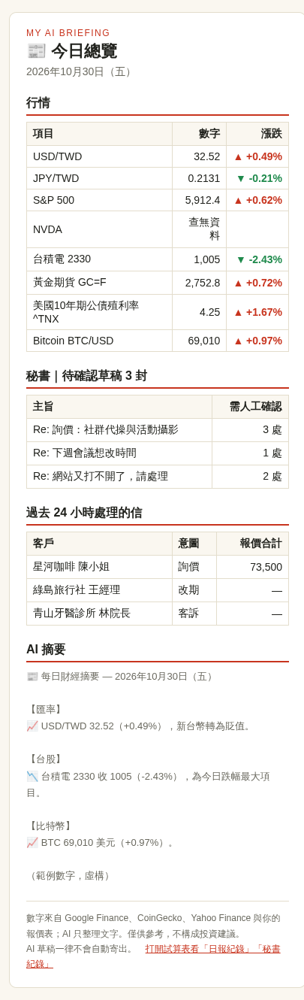

# Stage 2 Lab — 一鍵建立副本：真數據、自動寄信（動手）

> 目標：每天早上固定在 Gmail 收到一封數字可核對的「今日總覽」，版面挑你喜歡的；試算表同時幫你記下每天的數字。
> 需要：**個人** Google 帳號（免費）。不需要信用卡、不需要訂閱、**不需要看程式碼**。
> 想知道背後的程式在做什麼，或講師連結失效時，看 [`lab-assets/apps-script/`](../../lab-assets/apps-script/README.md)。

## 架構（對應 Stage 0 的積木）
```
① 排程   Apps Script 時間觸發器（預設每天 07:00，可以改）
② 取資料 Google Sheet（GOOGLEFINANCE）＋ CoinGecko ＋ Yahoo Finance 公開端點
③ 整理   OpenRouter 免費 AI 模型（不用綁卡）——只整理文字，不負責查數字
④ 推送   一封「今日總覽」寄給自己（財經＋Stage 4 之後的秘書待辦），三種版面任選
⑤ 存檔   試算表「日報紀錄」分頁每天記一列；同一份日報也存成 Markdown 到「FinLab-Vault」（Stage 3 用）
```

> 💡 **Apps Script 是什麼？** Google 內建在試算表裡的「小程式」功能，免費、不用安裝。講師已經把程式放進範本，你只要**建立副本、貼上一把鑰匙、按幾個選單**。

## A. 先準備：用個人帳號
- 用 `@gmail.com` 的個人帳號。**公司 Workspace 帳號**常被管理員擋掉 Apps Script 或 Gmail 權限，做到一半才卡住最可惜。
- 用電腦的 Chrome 操作最順；手機 app 看不到自訂選單。

## B. 建立你的副本
1. 打開講師提供的連結（網址結尾是 `/copy`）。
2. 按 **建立副本**。你的雲端硬碟會多一份「我的 AI 助理」試算表，裡面有：
   - **數據** 分頁：匯率、股票的 `GOOGLEFINANCE` 公式
   - **報價表** 分頁：Stage 4 秘書會用到
3. 等幾秒，上方選單列會出現 **📰 我的 AI 助理**（沒出現就重新整理一次）。

- ✅ **檢核點**：「數據」分頁的 C 欄都有數字。若某列 C 欄顯示 `#N/A`：匯率與台股加權指數程式會自動改用 Yahoo Finance 備援（信裡來源欄會註明）；其他列請換代碼或刪掉（代碼對照見 [範本說明](../../lab-assets/sheet-template/README.md)；黃金、BTC 不在這裡，程式會另外抓）。部分匯率的 D、E 欄空白是正常的，程式會自己算或寫「查無資料」。

## C. 申請 OpenRouter key（免費、不用綁卡）
OpenRouter 是一個「AI 模型總機」，一把 key 就能用很多家的免費模型。
1. 打開 [openrouter.ai](https://openrouter.ai) → 右上角 **Sign in** → **Continue with Google**，用你的 Google 帳號登入。
2. 打開 [Keys 頁面](https://openrouter.ai/settings/keys)（右上角頭像 → **Keys**）→ **Create**。名稱隨意填（例如 `finlab`），額度上限留空 → 建立。
3. 畫面會出現一串 **`sk-or-` 開頭** 的 key，**只會顯示這一次**：按複製，**先不要貼到任何其他地方**。
4. 不用儲值、不用填信用卡。本課程只用免費模型。

> 📏 **免費額度**（以官網為準，查證日期 2026-11-24，來源：[OpenRouter Limits](https://openrouter.ai/docs/api/reference/limits)）：免費模型每分鐘 20 次、每天 50 次（帳號累計購買點數少於 10 美元時）；每天台灣時間早上 8 點重置。每天寄一封日報只用 1～2 次，綽綽有餘。

> 🔒 key 是你的鑰匙：不要貼進表格、群組、截圖。詳見 [student-security-gmail-keys.md](student-security-gmail-keys.md)。

## D. 一鍵設定
1. 選單 **📰 我的 AI 助理 → ① 一鍵設定（第一次用）**。
2. 授權（第一次才會出現，**照著點就好**）：
   1. 「需要授權」→ **繼續** → 選你的帳號。
   2. 「**Google 尚未驗證這個應用程式**」→ 左下 **進階** → **前往「我的 AI 助理」（不安全）**。
      這是因為程式在你自己的副本裡、沒有送 Google 審查；**它不是病毒，也拿不到你的密碼**。每個權限在做什麼，見 [Apps Script README 的權限表](../../lab-assets/apps-script/README.md#這些權限是做什麼的)。
   3. 權限清單 → **全部勾選**（或按「全選」）→ **允許**。少勾的話，之後用到時會再跳一次授權。
   4. 授權完如果沒有跳出貼 key 的框，**再點一次 ① 一鍵設定**（第一次點選單常常只會跳授權）。
3. 跳出對話框 → 貼上 OpenRouter key → **確定**。還沒有 key、或想先只用原始數據的話，**這裡可以留空**再按確定：程式會關閉 AI 摘要，仍會建立知識庫。之後要開啟，再點一次 ① 貼上 key。
4. 看到「設定完成 ✅」。

- ✅ **檢核點**：看到「設定完成」；到 [Google 雲端硬碟](https://drive.google.com) 會看到新資料夾 **FinLab-Vault**（裡面有 `日報`、`秘書`、`筆記`、`標的` 等）。
- ❌ 看到「key 測試失敗」，照對話框裡的原因處理：
  - 「這看起來不是 OpenRouter key」：貼到別的東西了。OpenRouter key 是 `sk-or-` 開頭，回 Keys 頁面重新複製。
  - 「key 無效（401）」：key 沒貼完整，或已被刪除；到 Keys 頁面重建一把，再點一次 ①。
  - 「找不到可用的模型（404）」：免費模型可能剛好下架，程式已自動換備用模型試過。請講師更新 `Code.gs` 最上方的模型名稱；若你在 OpenRouter [隱私設定](https://openrouter.ai/settings/privacy) 排除了會保留資料的提供者，也可能找不到免費模型。
  - 「免費額度暫時用完（429）」：程式已自動換備用模型試過一次；等一分鐘再試。
  - 「今天的免費額度用完了（429）」：當天 50 次用完（整個帳號共用，換模型也一樣），台灣時間早上 8 點重置，明天再試。
  - 早上 7 點那封沒有 AI 摘要、只有原始數據：7 點還沒到額度重置時間，用的是前一天剩下的額度（以官網為準，查證日期 2026-11-24）。前一天用完的話就會這樣；8 點過後按「② 立即寄一封」或「↻ 只更新」就有摘要。
- ❌ 看到「知識庫資料夾建立失敗」：授權時沒勾雲端硬碟。再點一次 ①（key 留空就沿用），權限全部勾選。
- 其他錯誤：對話框會說明原因，試算表也會多一個「錯誤紀錄」分頁，把那一列給講師看。

## E. 試寄一封
1. 選單 **② 立即寄一封今日總覽**。
2. 到信箱檢查：主旨是「📰 今日總覽 日期（週幾）」，頁尾有「資料更新時間」；內容有財經摘要、秘書待辦（現在會寫「秘書尚未啟用」，Stage 4 之後才有內容）、原始數據。若一鍵設定時沒貼 key，摘要處會寫「AI 摘要已關閉，以下為原始數據。」，數字一樣可以核對。

| 測試 | 預期 |
|------|------|
| 信裡的數字 vs 原始數據 | 完全一致（AI 不能自己改數字；對不上時，摘要最上面會出現「⚠️ 自動檢查」提醒） |
| 故意把「數據」某列代碼改錯，再寄一次 | 該項寫「查無資料」，不是亂編 |
| 週末執行 | 信裡註明美股休市 |
| 信裡有沒有「建議買進」？ | 不應該有 |
| 試算表多了「日報紀錄」分頁 | 今天一列：日期、更新時間、更新方式（手動寄送）、每個項目的數字與漲跌% |
| 雲端硬碟 `FinLab-Vault/日報` | 多了一篇 `YYYY-MM-DD 財經日報.md` |

- ✅ **檢核點**：收到信，並完成上表至少前兩項。

> 💡 **只想更新數字、不想收信？** 點 **↻ 只更新數字與知識庫（不寄信）**：一樣會抓最新數字、更新「日報紀錄」和知識庫裡今天的日報，只是不寄信。AI 開著的話，每按一次會用掉 1～2 次免費額度（每天約 50 次，以官網為準，查證日期 2026-11-24），不要一直按。按 ↻ 時如果 AI 摘要失敗（例如額度用完），知識庫裡今天的日報 `.md` 會被改寫成只有原始數據，之前那份 AI 摘要就不見了。

## F. 挑一個你喜歡的版面
同一份內容有三種排法。先點 **🎨 寄三種版面樣張給我**，三封信並排比較，再點 **🎨 選擇信件版面** 輸入編號。

| 1. 精簡 | 2. 完整（預設） | 3. 表格 |
|---|---|---|
| 手機一眼看完：變動最大的 3 項＋秘書三個數字 | AI 摘要全文＋秘書待辦清單＋原始數據 | 主管版：行情表、待確認草稿表、昨日處理表 |
|  |  |  |

> 樣張數字為虛構。顏色依台灣習慣：**紅漲綠跌**。版面只負責排版，數字一律來自資料表。
> 想要第四種排法？版面寫在 `lab-assets/apps-script/Templates.gs`，可以請講師或懂程式的同事幫你加。

- ✅ **檢核點**：收到三封樣張，並選好一種版面。

## G. 日報紀錄：不用裝任何軟體也能看趨勢
打開試算表的 **日報紀錄** 分頁：每天自動多一列，每個追蹤項目一欄（數字＋漲跌%），還有秘書待辦的數量。「更新時間」是這一列最後一次更新的台灣時間，「更新方式」是每日排程、手動寄送或手動更新。
- 想看「這兩週匯率怎麼變」：選取 USD_TWD 那一欄 → **插入 → 圖表**，就有一條走勢線。
- 手機上用 Google 試算表 app 也看得到。
- 同一天重寄（或按「↻ 只更新」）會覆寫同一列，不會重複；「更新時間」會變成最新的那一次。
- 之前就用過的試算表，「更新時間」「更新方式」兩欄會自動加在最右邊。

## H. 設定每天自動寄
1. 選單 **③ 開啟每日 07:00 自動寄送**。
2. 想停：**④ 停止每日自動寄送**。
3. 想換時間（選做）：擴充功能 → Apps Script → 左側 **專案設定（齒輪）→ 指令碼屬性** → 新增屬性 `REPORT_HOUR`，值填 0～23 的整數（例如 `6` 就是早上 6 點）→ 儲存。**再點一次「③」才會生效**；重新整理試算表，選單上的時間也會跟著變。填錯（例如 `abc`、`25`）會用預設的 7 點。

- ⚠️ 免費額度每天台灣時間 8 點才重置（以官網為準，查證日期 2026-11-24），所以 7 點那封用的是前一天剩下的額度；前一天用完的話，那封信只會有原始數據、沒有 AI 摘要。
- ✅ **檢核點**：隔天早上自動收到信（會在 7 點這個小時內寄出，不一定剛好 7:00）；「日報紀錄」那一列的「更新方式」是「每日排程」。

## 你應該觀察到的天花板
- Google Finance 可能延遲、少數代碼沒資料。
- 美國國定假日無法自動判斷，要靠「原始數據」自己核對。
- Yahoo 公開端點非官方，可能變動。
- OpenRouter 免費模型的名單與額度會變，以官網為準（查證日期 2026-11-24）。預設的 `openrouter/free` 每次可能挑到不同模型，摘要文筆會有差異；數字以「原始數據」為準。
- 「AI 趨勢」目前只依數據評論，沒有新聞；要加新聞需要另外的資料來源。
- 「日報紀錄」只有數字，沒有你的想法；想寫下觀察、把日報和報價單串在一起，試算表就不夠用了。→ Stage 3 用知識庫解決（選修，裝不了軟體的人用日報紀錄就夠）。

## 帶走
- 可靠日報＝**資料來源可核對 ＋ AI 只做整理 ＋ 固定管道推送**。
- 課後怎麼擴充：在「數據」分頁加你的追蹤項目、寄給團隊（指令碼屬性 `REPORT_TO`）。見 [免費工具選單](student-free-tools-menu.md)。
- 下一關（Stage 3）：每天的日報已經默默存進 `FinLab-Vault`，接著用 Obsidian 把它變成會累積的知識庫。
