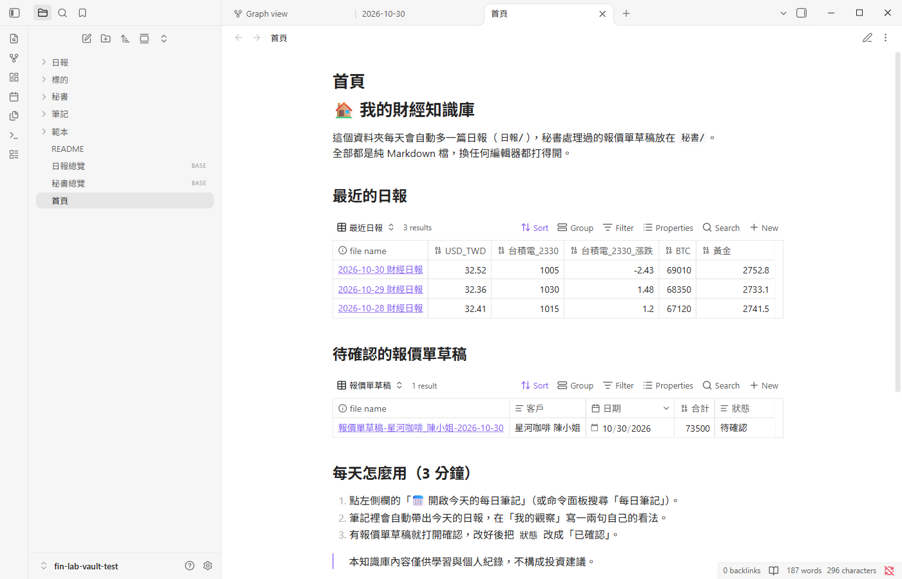
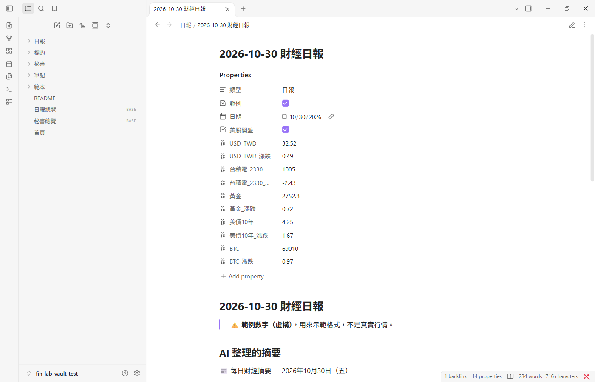
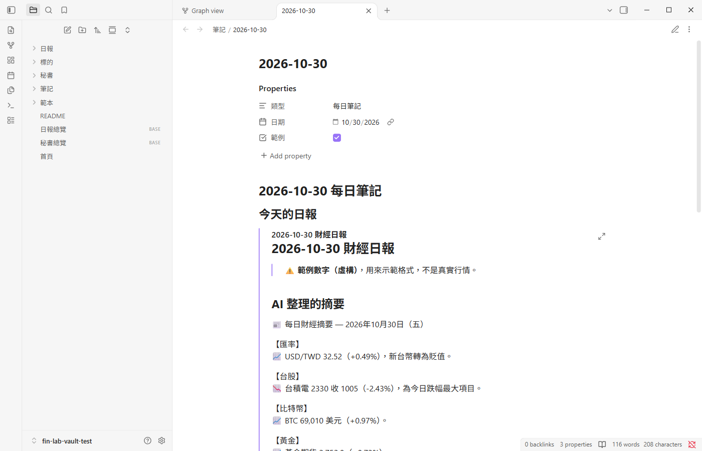
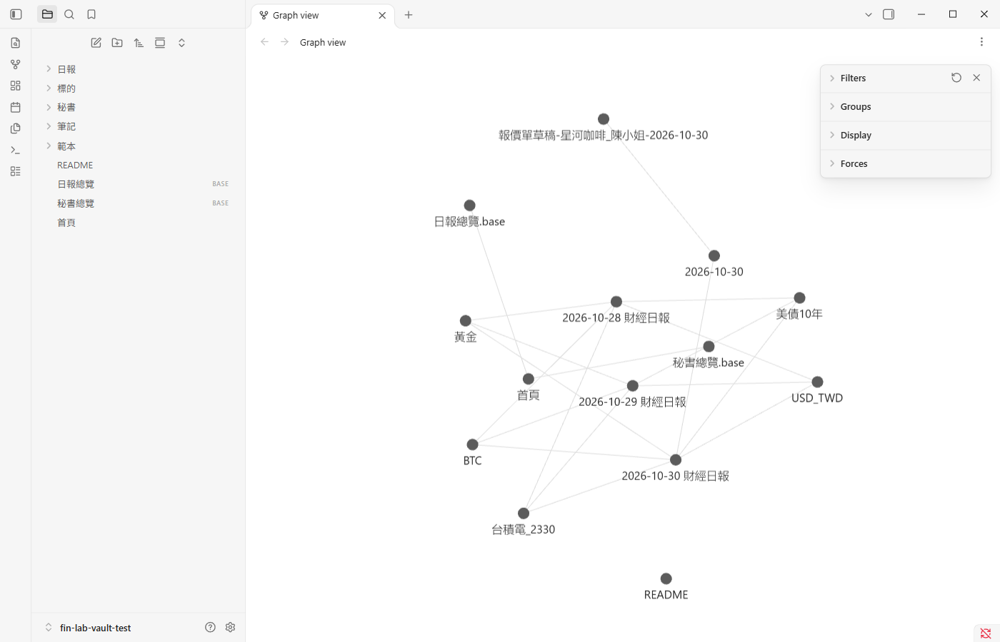

# Stage 3 Lab — 把日報變成你的財經知識庫（Markdown 資料夾 × Obsidian）

> 目標：每天的日報自動累積在自己電腦的一個資料夾，打開就能看「這兩週匯率怎麼變」，還能寫下自己的觀察。
> 需要：Stage 2 做完（雲端硬碟已經有 `FinLab-Vault`）；一台 Windows 或 Mac 電腦。全部免費。

> 💡 **這一段是加分題。** 每天看「今日總覽」信、用試算表「日報紀錄」看趨勢，已經夠用。
> 公司電腦不能裝軟體也沒關係，跟著看講師示範就好；想**寫下自己的觀察、把日報和報價單串在一起**的人，再往下做。

## 先搞懂一件事：資料夾才是主角，Obsidian 只是「檢視器」

```
Apps Script 每天寫一篇 .md ──►  Google 雲端硬碟 FinLab-Vault/  ──► 同步到你的電腦
                                                              │
                                     用 Obsidian 打開（推薦）  ├─ 或 VS Code、Typora、記事本
```

- `.md`（Markdown）是**純文字檔**，任何電腦、任何編輯器都打得開。
- 所以你的資料**不會被任何一套軟體綁住**；哪天不想用 Obsidian，資料夾帶著走就好。
- 我們推薦 Obsidian，是因為它免費、有繁體中文介面，而且**內建**每日筆記、範本、表格儀表板，不用另外安裝外掛。

> 免費說明：Obsidian 個人與商業用途皆免費；付費的 Sync（同步）、Publish（發布）本課程**用不到**。以官網為準（查證日期 2026-10-31）。

## A. 把 FinLab-Vault 同步到電腦

**主線：Google 雲端硬碟電腦版**
1. 下載安裝 [Google 雲端硬碟電腦版](https://www.google.com/drive/download/)，用 Stage 2 的同一個帳號登入。
2. 安裝後檔案總管（Mac 是 Finder）會出現「Google 雲端硬碟」：
   - Windows：通常是 `G:\我的雲端硬碟\FinLab-Vault`
   - Mac：Finder 側欄「Google Drive → 我的雲端硬碟 → FinLab-Vault」
3. 在 `FinLab-Vault` 上按右鍵 → **離線存取 → 可離線使用**（讓 Obsidian 讀得到完整檔案，不是只有雲端捷徑）。

- ✅ **檢核點**：在電腦上打開 `FinLab-Vault/日報`，看得到 Stage 2 寄出的那篇 `.md`。

**備援：不能安裝雲端硬碟電腦版（例如公司電腦被鎖）**
- 到 [drive.google.com](https://drive.google.com) → 在 `FinLab-Vault` 上按右鍵 → **下載**（會下載成 zip）→ 解壓縮到「文件」資料夾。
- 缺點是不會自動更新，想看新日報要再下載一次。建議一週下載一次就好。

## B. 安裝 Obsidian，打開 vault
1. 到 [obsidian.md](https://obsidian.md/download) 下載安裝（Windows 不需要系統管理員權限）。
2. 第一次開啟 →「**開啟資料夾作為 vault**（Open folder as vault）」→ 選上一步的 `FinLab-Vault`。
3. 介面是英文的話：左下 ⚙️ **Settings → General → Language → 繁體中文**，重新啟動。
4. 如果跳出「是否信任這個 vault 的作者」，選 **信任**（這個 vault 沒有任何外掛，只有筆記）。

- ✅ **檢核點**：左側看得到 `日報`、`秘書`、`筆記`、`範本` 資料夾，以及 `首頁`。

## C. 看首頁：儀表板自動整理每天的數字
點左側 **首頁**。「最近的日報」是一張表格，每一列是一天、每一欄是一個追蹤項目，**最新的在最上面**。



- 這張表是 Obsidian 內建的 **Bases** 功能，讀的是每篇日報最上方的「屬性」（數字由程式從資料表寫入，**不是 AI 寫的**）。
- 剛開始只有 1 篇日報，表格只有 1 列；每天會自動多一列。
- 想先看看累積兩週的樣子：講師會用範例 vault（`lab-assets/obsidian-vault/`）示範。

## D. 打開一篇日報
點表格中的日報名稱。



- 最上面「屬性」是當天的數字；往下是 AI 摘要，最後是「原始數據」表格。
- 原始數據裡的項目名稱是**連結**（例如 `USD/TWD`），點下去會進到 `標的/` 資料夾裡這個項目的筆記（股票、匯率、加密貨幣都放這裡）。第一次點會是灰色的「尚未建立」，點了就會在 `標的/` 建一篇空白筆記，你可以寫「我為什麼追蹤它」。一鍵設定已經幫你建好這個資料夾；若要改名，到 Apps Script「專案設定 → 指令碼屬性」新增 `VAULT_SYMBOL_FOLDER`（例如「觀察清單」），再跑一次 ①，並自行把舊筆記移過去。若 vault 根目錄裡已經有舊連結（例如 `[[USD_TWD]]`）建出來的標的筆記，請自行移到 `標的/`（或你設定的 `VAULT_SYMBOL_FOLDER`）。

## E. 每日筆記：AI 給數字，你寫觀察（每天 3 分鐘）
1. 左側欄點 📅「**開啟今天的每日筆記**」（或 `Ctrl/Cmd + P` 搜尋「每日筆記」）。
2. 系統會在 `筆記/` 建立今天的筆記，**自動嵌入今天的日報**。
3. 在「我的觀察」寫一兩句自己的看法，在「今天要追的事」列待辦。



> 為什麼要自己寫？AI 只能描述數字變化，**判斷是你的**。這也是本課程的原則：報告不給投資建議，決策留給人。

- ✅ **檢核點**：`筆記/` 裡有今天日期的筆記，裡面看得到今天的日報內容。
  （若日報還沒寄出，嵌入處會顯示「找不到」，等 8 點後再看即可。）

## F. 關聯圖：看見「哪些天提到哪個標的」
左側欄點 **關聯圖（Graph view）**。每個點是一篇筆記，線是連結。



- 日報會連到每個標的；你在每日筆記裡連到報價單、標的，圖也會跟著長出來。
- 點某個標的的筆記，右側欄「**反向連結（Backlinks）**」會列出所有提到它的日報。

## G. 可攜驗證：換一個編輯器也打得開
用記事本（Mac 用「文字編輯」）打開 `FinLab-Vault/日報` 裡任一篇 `.md`：

```markdown
---
類型: 日報
日期: 2026-10-30
USD_TWD: 32.52
...
---
# 2026-10-30 財經日報
```

看得懂就對了：**全部是純文字**。這就是「不被套裝軟體綁住」的意思。

## 你應該觀察到的天花板
- 手機上看日報還是靠 Gmail；Obsidian 手機版要讀到 Google 雲端硬碟資料夾並不容易（官方 Sync 要付費），本課程不需要。
- 儀表板欄位是固定的（USD_TWD、台積電_2330、BTC、黃金）。你在「數據」分頁新增或改名項目後，要到 `日報總覽.base` 加欄位（在表格上按 **Properties** 勾選即可）。
- 知識庫只會累積「數字＋你的觀察」，不會自己去找新聞。

## 選修：在 vault 裡問 AI「這兩週匯率怎麼變？」
主線不需要。想玩的人二選一（都以官網為準）：
- **免費**：社群外掛 **Copilot**，在設定裡選 OpenRouter、填 OpenRouter key（可以跟 Stage 2 用同一把，或另外建一把；額度共用），模型選名稱結尾是 `:free` 的免費模型。第一次安裝社群外掛要先關閉「限制模式（Restricted mode）」。
- **已有 Claude 訂閱**：外掛 **Claude Panel**，並在 vault 根目錄放一份「只答 vault、找不到就說沒有」的規則檔（做法參考姊妹課程 low-code-rag-lab 的 `obsidian/` 資料夾）。

> ⚠️ 外掛裡填的 key 會存在 `FinLab-Vault/.obsidian/plugins/` 底下。**不要把整個 vault 分享給別人**，要分享就只挑 `.md` 檔。

## 帶走
- 知識庫＝**一個純文字資料夾**＋一個好用的檢視器。資料是你的，軟體可以換。
- 每天 3 分鐘：看儀表板 → 打開每日筆記 → 寫一句自己的觀察。
- 下一關（Stage 4）：同一套流程換個用途，讓 AI 幫你把客戶來信變成回覆草稿與報價單。
