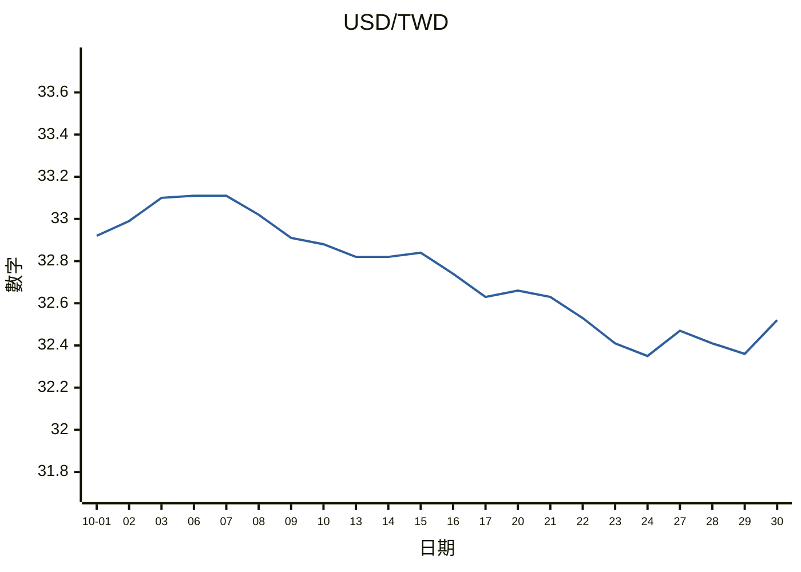

# USD/TWD

<!-- 自動更新開始：這兩行之間由 Apps Script 產生，請不要在中間寫字 -->
> 這篇筆記是程式在「USD/TWD」第一次出現在日報時自動建立的。分類由程式依代碼判斷，不對可以直接改上方的 `分類`。

## 這些欄位是什麼意思

- **數字**：最近一次抓到的價格、點數或殖利率。
- **漲跌 %**：和前一個收盤相比的百分比；📈 是漲、📉 是跌。
- 查無資料的日子留空，程式不會自己補數字。
- 匯率的數字是「1 單位前面的貨幣可以換多少後面的貨幣」。例如 USD/TWD 32.5＝1 美元換 32.5 新台幣；數字往上＝前面的貨幣變貴（後面的貨幣貶值）。

## 走勢圖（最近 30 天）



> 圖的數字來自試算表「日報紀錄」分頁：2026-10-01～2026-10-30，畫了 22 天；8 天休市沿用前一天的數字，沒有重複畫。第一次出現「Display Mermaid diagrams in this vault?」時按 Allow 才會顯示圖；看不到圖時，請看下面的表格。

## 近期走勢（最近 14 篇日報）

```base
filters:
  and:
    - file.inFolder("日報")
properties:
  file.name:
    displayName: 日報
  note.USD_TWD:
    displayName: 數字
  note.USD_TWD_漲跌:
    displayName: 漲跌 %
views:
  - type: table
    name: 近期走勢
    order:
      - file.name
      - "USD_TWD"
      - "USD_TWD_漲跌"
    sort:
      - property: 日期
        direction: DESC
    limit: 14
```

> 表格用 Obsidian 內建的「Bases」（1.9 以上），數字直接讀每篇日報上方的欄位；點日期就能打開那天的日報。
<!-- 自動更新結束 -->

## 我為什麼追蹤它（自己寫）

- 公司有美元收款，月底換匯前會先看一下。（範例）

## 觀察紀錄

- 2026-10-30：連兩天在 32.4～32.5 之間。（範例）

> 想看它出現在哪幾天的日報：打開右側欄的「反向連結（Backlinks）」。本筆記僅供學習紀錄，不構成投資建議。
